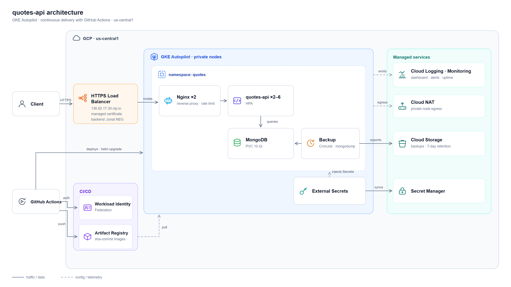

# Arquitectura

Lo que está desplegado en `proyect-kambista-challenge` (`us-central1`).



## Componentes

| Capa | Recurso | Descripción |
|---|---|---|
| **Red** | VPC `quotes` / subnet `quotes-us-central1` | La red usa `10.10.0.0/20` para nodos, `10.20.0.0/16` para pods y `10.30.0.0/20` para services. También se habilitó Private Google Access, de modo que los nodos pueden llegar a Artifact Registry y Secret Manager sin salir por el NAT. |
| | Cloud NAT `quotes-nat` | Permite que los nodos, que no tienen IP pública, puedan acceder a Internet. Se utiliza principalmente para descargar las imágenes de Nginx, Mongo y curl desde Docker Hub, las cuales están fijadas por digest para que no cambien sin un commit de por medio. |
| | Firewall `quotes-allow-lb-health-checks` | Se permite tráfico al puerto `8080` únicamente desde los rangos utilizados por el Load Balancer y sus health checks, es decir, `130.211.0.0/22` y `35.191.0.0/16`. |
| **Cómputo** | GKE Autopilot `quotes` | Cluster regional en el canal REGULAR, cuyos nodos no tienen IP pública y usan una service account propia (`quotes-gke-nodes`) que solo puede leer el repositorio de Artifact Registry. El acceso al control plane se realiza mediante el endpoint DNS con IAM o mediante las redes autorizadas configuradas. |
| **Entrada** | GCE Ingress + `ManagedCertificate` | El tráfico externo entra mediante un Application Load Balancer creado por el GCE Ingress, con la IP estática `quotes-ingress-ip`, y se expone en `https://136.82.17.30.nip.io`. Además, el `FrontendConfig` redirige HTTP a HTTPS y exige TLS 1.2 o superior. El balanceador llega a los pods de Nginx a través de NEGs, mientras que el health check apunta a `/healthz` y está definido mediante `BackendConfig`. Cloud Armor quedó definido en Terraform, pero actualmente está deshabilitado porque el proyecto no tenía cuota disponible para security policies. |
| **Aplicación** | `quotes-nginx` → `quotes-api` | Nginx 1.30 funciona como reverse proxy con dos réplicas y se encarga de headers, timeouts y del endpoint `/healthz`. Además, aplica un rate limit de 10 req/s por IP en cada réplica, tomando la IP real del cliente desde `X-Forwarded-For`. Por su parte, la API escala automáticamente entre 2 y 6 réplicas cuando la CPU supera el 60%, y un PodDisruptionBudget mantiene al menos una réplica disponible durante mantenimientos. |
| **Datos** | `mongodb-0` | MongoDB 7.0 se ejecuta como instancia standalone sobre un volumen `standard-rwo` de 10 Gi, con 500m de CPU y 1 GiB de memoria. En cada despliegue, un Job de Helm crea el índice `{pair: 1, createdAt: -1}`, que es el que utiliza `GET /quotes`. La API utiliza un usuario con permisos `readWrite` sobre la base `quotes`; no utiliza la cuenta root. |
| **Secretos** | Secret Manager + ESO | Las credenciales se generan desde Terraform y se almacenan en Secret Manager. Luego, ESO sincroniza los secretos necesarios dentro del cluster mediante el `ClusterSecretStore` `gcp-secret-manager`, que solo atiende al namespace `quotes`. Para ello se autentica con Workload Identity a través de su KSA, por lo que únicamente puede leer los tres secretos de Mongo. Cada chart define solo los secretos que necesita mediante su `ExternalSecret`. |
| **Backups** | CronJob `mongodb-backup` | Se ejecuta un `mongodump` diario a las 06:00 UTC y el resultado se almacena en `gs://proyect-kambista-challenge-mongo-backups`, donde los backups se conservan durante 7 días. El job solo tiene permiso para crear objetos en el bucket, mientras que el restore se realiza con `scripts/mongo-restore.sh` y ya fue probado. |
| **CI/CD** | GitHub Actions + WIF | GitHub Actions se autentica mediante Workload Identity Federation, por lo que no es necesario almacenar llaves JSON. El pool está restringido a los tokens provenientes del repositorio del fork, validados por ID de repositorio y de owner. En cada push se construye la imagen con el tag `sha-<commit>`, se despliegan con Helm solo los charts que cambiaron y, al final, se ejecuta un smoke test. Los PRs, a su vez, pasan validaciones de Terraform y Helm junto con un escaneo de Trivy. |
| **Observabilidad** | Cloud Logging / Monitoring | Nginx y la API generan logs en formato JSON, y el Load Balancer registra cada request. Además, se configuró un dashboard `quotes overview`, un uptime check sobre `/health` y alertas por correo para caídas, respuestas `5xx` y reinicios de los workloads. |

## Tráfico entre pods

Las NetworkPolicies cierran el camino a lo estrictamente necesario:

```
LB de Google (35.191.0.0/16, 130.211.0.0/22) → quotes-nginx:8080
quotes-nginx                                 → quotes-api:3000
quotes-api, mongodb-backup                   → mongodb:27017
```

## Identidades

| Quién | Cómo se autentica | Permisos |
|---|---|---|
| GitHub Actions | WIF → SA `github-deployer` | `container.developer` en el proyecto, `artifactregistry.writer` en el repo |
| Nodos GKE | SA `quotes-gke-nodes` | `container.defaultNodeServiceAccount`, `artifactregistry.reader` en el repo |
| ESO (`external-secrets/external-secrets`) | Workload Identity, principal directo | `secretmanager.secretAccessor` solo en los 3 secretos de Mongo |
| Backup (`quotes/mongodb-backup`) | Workload Identity, principal directo | `storage.objectCreator` solo en el bucket de backups |
