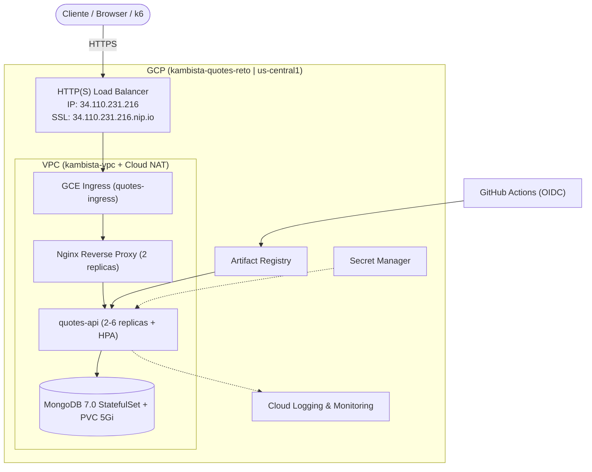

# Arquitectura Desplegada - quotes-api en GCP

## Flujo de Trafico y Componentes
1. **Entrada y TLS:** Trafico hacia `34.110.231.216` (`34.110.231.216.nip.io`) en el HTTP(S) Load Balancer con certificado SSL administrado (`ManagedCertificate`).
2. **Ingress y Reverse Proxy:** GCE Ingress enruta hacia `nginx-proxy` (`BackendConfig` en `/healthz`), aplicando rate limiting (`20r/s`), cabeceras `X-Forwarded-*` y proxy a `quotes-api:3000`.
3. **Aplicacion y HPA:** `quotes-api` corre con 2 replicas, probes (`/health` y `/ready`), `terminationGracePeriodSeconds: 15` y HPA (2 a 6 replicas al 60% CPU).
4. **Persistencia y Seguridad:** MongoDB 7.0 en `StatefulSet` (`PVC` 5Gi `standard-rwo`), nodos privados con Cloud NAT y CI/CD por OIDC sin llaves JSON.
