# Evidencia

## URL pública y output de `curl`

URL: `https://136.82.17.30.nip.io`

```
$ curl https://136.82.17.30.nip.io/health
{
  "service": "quotes-api",
  "status": "ok",
  "mongo": "connected",
  "uptime": 52985.280606446
}
```

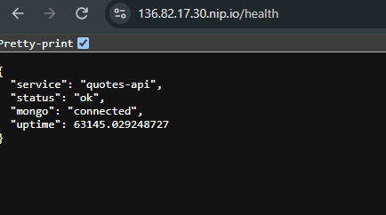

```
$ curl https://136.82.17.30.nip.io/quotes
{
  "count": 3,
  "items": [
    {
      "_id": "6b027935f70e72305678c74e",
      "pair": "USD/PEN",
      "buy": 3.7,
      "sell": 3.75,
      "source": "smoke-9e07b39",
      "createdAt": "2026-11-22T05:10:13.012Z",
      "updatedAt": "2026-11-22T05:10:13.012Z",
      "__v": 0
    },
    {
      "_id": "6b027673f503bf122eb8cdd3",
      "pair": "USD/PEN",
      "buy": 3.7,
      "sell": 3.75,
      "source": "smoke-71e82c7",
      "createdAt": "2026-11-22T04:58:27.658Z",
      "updatedAt": "2026-11-22T04:58:27.658Z",
      "__v": 0
    },
    {
      "_id": "6b026d7d3003f6c30f722291",
      "pair": "USD/PEN",
      "buy": 3.7,
      "sell": 3.75,
      "source": "smoke-c30100c",
      "createdAt": "2026-11-22T04:20:13.165Z",
      "updatedAt": "2026-11-22T04:20:13.165Z",
      "__v": 0
    }
  ]
}
```

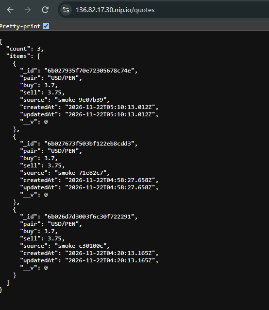

## `kubectl get pods,svc,ingress -A`

```
$ kubectl get pods,svc,ingress -A
```

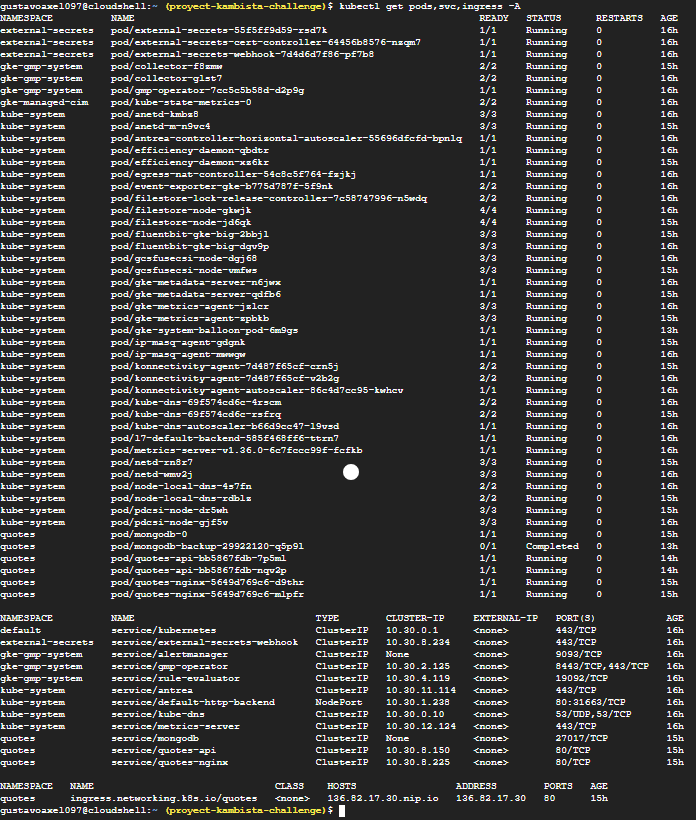

## Certificado HTTPS

```
$ kubectl describe managedcertificate quotes -n quotes
```

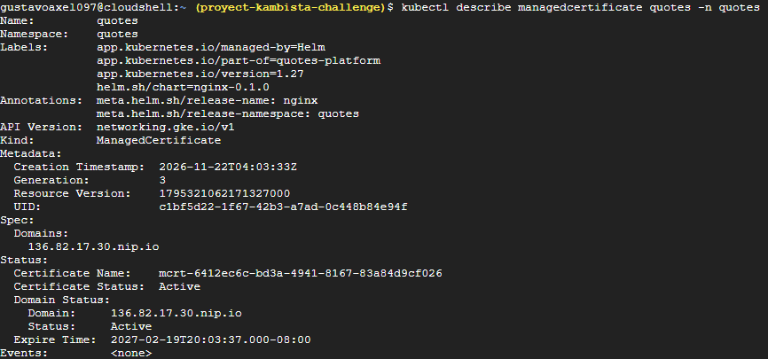

## Pipeline de GitHub Actions

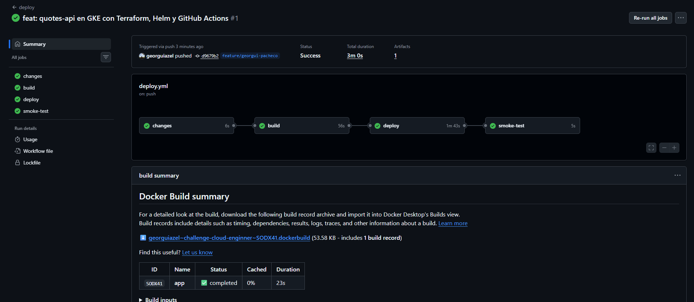

## Artifact Registry

```
Artifact Registry → quotes → quotes-api
```

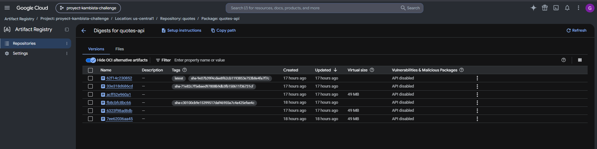

## Dashboard de Cloud Monitoring

```
Cloud Monitoring → Dashboards → quotes overview
```

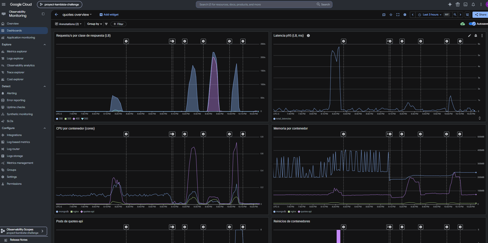

## Alerta

```
Cloud Alerting → quotes - reinicios de contenedores (correo)
```

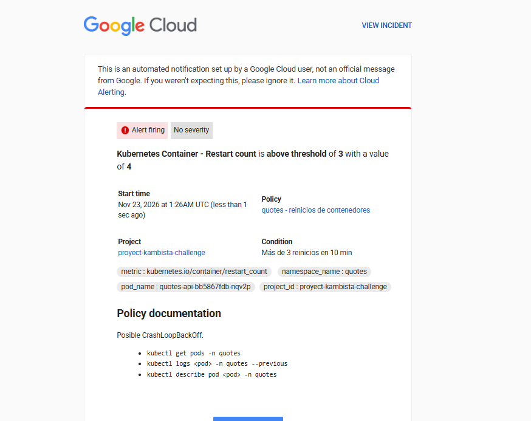

## HPA bajo carga (k6)

```
$ docker run --rm -i grafana/k6 run -e BASE_URL=https://136.82.17.30.nip.io - < load-test/k6-quotes.js

  █ THRESHOLDS

    http_req_duration{name:GET /quotes}
    ✗ 'p(95)<500' p(95)=738.03ms

    http_req_duration{name:POST /quotes}
    ✓ 'p(95)<800' p(95)=719.81ms

    http_req_failed
    ✓ 'rate<0.01' rate=0.00%

  █ TOTAL RESULTS

    checks_total.......: 68363  113.879166/s
    checks_succeeded...: 99.99% 68359 out of 68363
    checks_failed......: 0.00%  4 out of 68363

    HTTP
    http_req_duration..............: avg=289.62ms min=135.99ms med=201.04ms max=11.51s p(90)=504.52ms p(95)=735.77ms
      { name:GET /quotes }.........: avg=291.55ms min=139.45ms med=202.51ms max=11.51s p(90)=506.62ms p(95)=738.03ms
      { name:POST /quotes }........: avg=282.13ms min=135.99ms med=195.21ms max=11.31s p(90)=494.14ms p(95)=719.81ms
    http_req_failed................: 0.00%  4 out of 68363
    http_reqs......................: 68363  113.879166/s

    EXECUTION
    iterations.....................: 68363  113.879166/s
    vus_max........................: 80     min=80         max=80
```

```
$ kubectl get hpa -n quotes -w
```

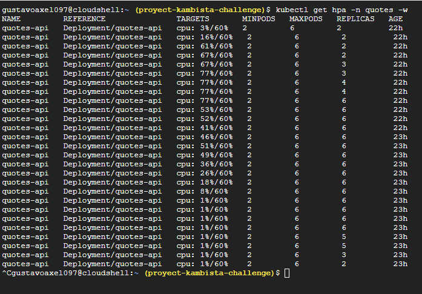

```
$ kubectl get pods -n quotes -l app=quotes-api -o wide -w
```

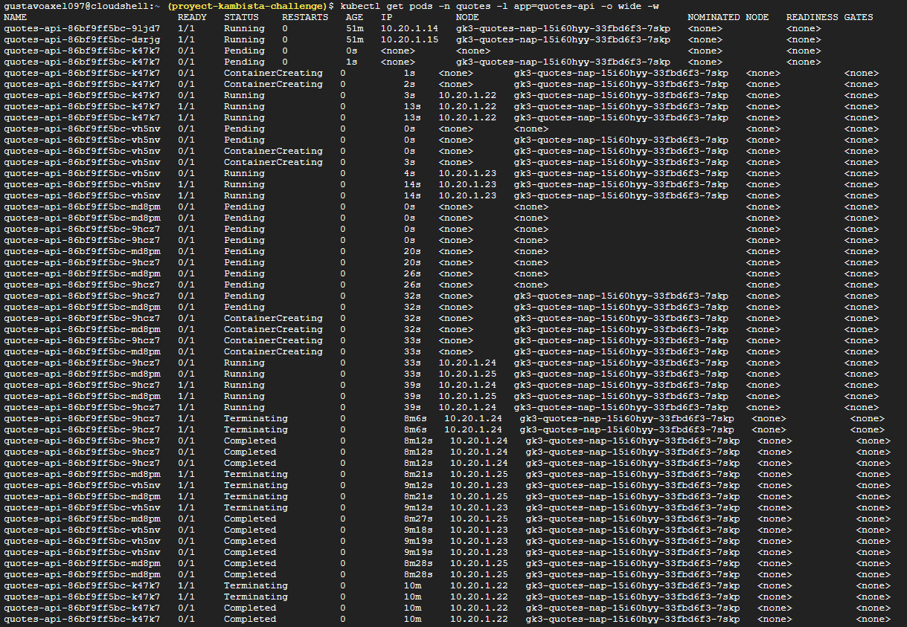

## Backup de MongoDB en GCS

```
Cloud Storage → proyect-kambista-challenge-mongo-backups → mongodb
```

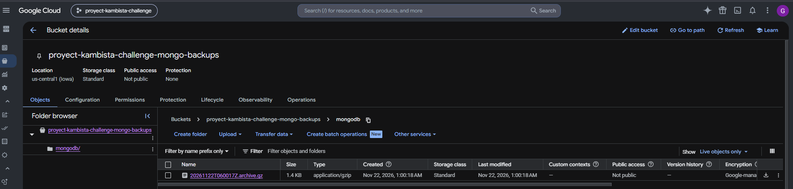
