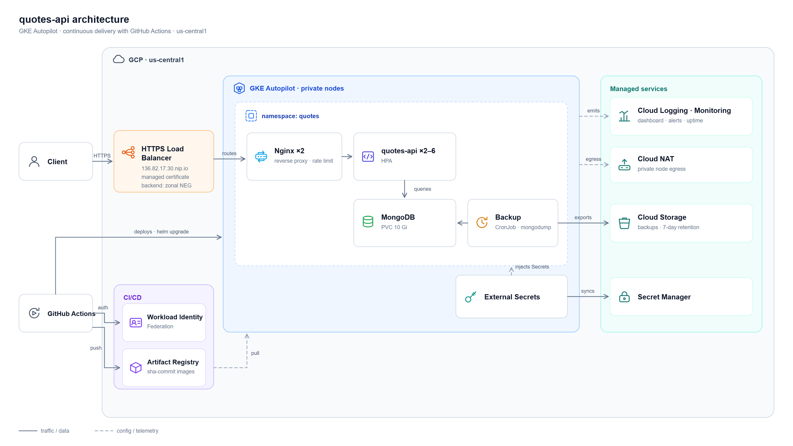

# Runbook — quotes-api

---

## 1. Resumen del servicio

- **Nombre del servicio:** quotes-api
- **Dueños:** `@georguiazel`
- **Repositorio:** https://github.com/georguiazel/challenge-cloud-enginner
- **URL pública:** `https://136.82.17.30.nip.io`
- **Entorno:** producción
- **Región GCP:** us-central1
- **Proyecto GCP:** proyect-kambista-challenge
- **On-call:** `@georguiazel`. Las alertas se envían al correo configurado en `alert_email`.

## 2. Diagrama de arquitectura



Detalle de componentes, tráfico entre pods e identidades en [arquitectura.md](./arquitectura.md).

## 3. SLOs / Objetivos

| Métrica | Objetivo | Cómo medimos |
|---|---|---|
| Disponibilidad | 99.0% mensual | Uptime check `quotes /health`, cada 60 s desde varias regiones |
| Latencia p95 | < 500 ms | `loadbalancing.googleapis.com/https/total_latencies` en el dashboard |
| Error rate | < 1% 5xx | `https/request_count` por `response_code_class` |

El objetivo de error es < 1%, mientras que la alerta está configurada en 5% durante 5 minutos para evitar alertas por errores aislados o tráfico bajo.

## 4. Accesos y herramientas

- **Consola GCP:** https://console.cloud.google.com/?project=proyect-kambista-challenge
- **Clúster GKE:** el acceso es por DNS endpoint, ya que el endpoint IP solo acepta las redes de `authorized_networks`.
  ```bash
  gcloud container clusters get-credentials quotes \
      --location us-central1 --project proyect-kambista-challenge --dns-endpoint
  ```
- **Logs:**
  ```bash
  kubectl logs -n quotes -l app=quotes-api --tail=200 -f
  kubectl logs -n quotes -l app=quotes-nginx --tail=200 -f
  ```
  En Logs Explorer: `resource.type="k8s_container" resource.labels.namespace_name="quotes"`.
- **Métricas:** dashboard `quotes overview` en https://console.cloud.google.com/monitoring/dashboards?project=proyect-kambista-challenge
- **Alertas:** https://console.cloud.google.com/monitoring/alerting/policies?project=proyect-kambista-challenge
- **Pipeline:** https://github.com/georguiazel/challenge-cloud-enginner/actions/workflows/deploy.yml
- **Imagen:** `us-central1-docker.pkg.dev/proyect-kambista-challenge/quotes/quotes-api:<tag>`

## 5. Deploy

### Deploy normal

1. Push o merge a `main` o `feature/**` ejecuta `deploy.yml`.
2. El pipeline:
   - Detecta qué cambió (`app/`, `helm/quotes-api`, `helm/mongodb`, `helm/nginx`).
   - Si cambió la API, construye la imagen y la sube con los tags `sha-<commit>` y `latest`.
   - Ejecuta `helm upgrade --install` de los charts que cambiaron, en orden mongodb → quotes-api → nginx. La API y Nginx usan `--atomic`, por lo que un deploy fallido vuelve automáticamente a la versión anterior.
   - Corre el smoke test: `/health`, un `POST /quotes` y un `GET /quotes` que verifica el registro creado.
3. Verificar con `kubectl rollout status deploy/quotes-api -n quotes`.
4. Probar `curl https://136.82.17.30.nip.io/health`.

Un push despliega solo lo que cambió, mientras que *Actions → deploy → Run workflow* despliega los tres charts.

### Deploy manual de emergencia

Para mantener el estado consistente con el pipeline, los cambios manuales deben hacerse mediante Helm:

```bash
helm upgrade quotes-api helm/quotes-api -n quotes \
  --reuse-values --set image.tag=sha-<commit> --wait --atomic
kubectl rollout status deployment/quotes-api -n quotes
```

Si Helm no está disponible:

```bash
export IMAGE=us-central1-docker.pkg.dev/proyect-kambista-challenge/quotes/quotes-api:sha-<commit>
kubectl set image deployment/quotes-api quotes-api=$IMAGE -n quotes
kubectl rollout status deployment/quotes-api -n quotes
```

En ambos casos, el repositorio debe actualizarse con la versión que quedó desplegada para que el siguiente deploy no la revierta.

## 6. Rollback

El pipeline despliega la API y Nginx con `--atomic`, así que un release que no llega a `Ready` se revierte solo. El rollback manual aplica cuando el deploy terminó bien pero la versión nueva se comporta mal:

```bash
helm history quotes-api -n quotes
helm rollback quotes-api -n quotes            # versión anterior
helm rollback quotes-api 3 -n quotes          # revisión específica
```

Funciona igual con `nginx` y `mongodb`. Conviene hacerlo con Helm y no con `kubectl rollout undo`, porque así el historial del release queda alineado con lo que corre en el clúster.

La API no usa migraciones, por lo que volver a una imagen anterior no toca los datos de Mongo; tampoco lo hace un rollback del chart `mongodb`, que solo cambia manifiestos y deja el PVC intacto. Si lo que se dañó fueron los datos, lo que corresponde es restaurar el último backup desde la sección 9.

Para confirmar, los pods deben quedar `Running` y `/health` debe responder:

```bash
kubectl get pods -n quotes
curl -s https://136.82.17.30.nip.io/health
```

## 7. Troubleshooting

### 7.1. El servicio devuelve 502 / 503

Casi siempre es una de cuatro cosas: pods caídos, un Service sin endpoints, Mongo sin responder o el health check del LB fallando. Conviene revisarlas en ese orden.

```bash
kubectl get pods -n quotes
kubectl describe svc quotes-api -n quotes
kubectl exec -n quotes mongodb-0 -c mongodb -- mongosh --quiet --eval "db.runCommand({ping:1})"
kubectl describe ingress quotes -n quotes       # ingress.kubernetes.io/backends debe decir HEALTHY
```

Si hay pods en `CrashLoopBackOff`, el motivo suele estar en `kubectl logs <pod> -n quotes --previous`. Un Service sin endpoints indica que los pods de la API no pasan la readiness, y `kubectl describe pod` muestra por qué. Cuando el LB devuelve 502 y Nginx no registra errores, el problema suele ser el health check: `kubectl exec -n quotes deploy/quotes-nginx -- wget -qO- localhost:8080/healthz`.

### 7.2. Latencia alta

El `upstream_time` de los logs de Nginx indica si la demora viene de atrás. Si es alto, hay que mirar la API y Mongo:

```bash
kubectl top pods -n quotes
kubectl get hpa -n quotes
kubectl exec -n quotes mongodb-0 -c mongodb -- sh -c \
  'mongosh --quiet -u root -p "$MONGO_INITDB_ROOT_PASSWORD" --authenticationDatabase admin \
   --eval "db.getSiblingDB(\"quotes\").quotes.getIndexes().map(i => i.name)"'
```

Si `mongodb-0` está en su límite de 500m, agregar réplicas de la API no ayuda porque el cuello de botella es la base; lo que sirve es subir sus `resources`. También hay que confirmar que exista `pair_1_createdAt_-1`, que es el índice que usa `GET /quotes`. Si falta, volver a desplegar el chart de Mongo hace que el Job `mongodb-indexes` lo cree de nuevo. Para ver queries lentas en curso:

```bash
kubectl exec -n quotes mongodb-0 -c mongodb -- sh -c \
  'mongosh --quiet -u root -p "$MONGO_INITDB_ROOT_PASSWORD" --authenticationDatabase admin \
   --eval "db.getSiblingDB(\"quotes\").currentOp({secs_running: {\$gte: 1}})"'
```

### 7.3. HPA no escala

```bash
kubectl describe hpa quotes-api -n quotes
kubectl top pods -n quotes
```

Los eventos del HPA suelen explicar el motivo. En Autopilot, Google gestiona metrics-server, así que si `kubectl top` responde, las métricas están llegando. Los `requests` están definidos en `helm/quotes-api/values.yaml`. Si ya llegó a las 6 réplicas, hay que subir `maxReplicas` y desplegar.

### 7.4. Pipeline falla al desplegar

```bash
gh run view <id> --log-failed
kubectl get events -n quotes --sort-by=.lastTimestamp
```

| Dónde falla | Por qué | Cómo se resuelve |
|---|---|---|
| `auth` con `unauthorized_client` | WIF valida el repo por ID numérico, no por nombre, y no coincide con `github_repository_id` / `github_owner_id` | Corregir `terraform.tfvars` y aplicar |
| `get-gke-credentials` o `helm` con `403` | A `github-deployer` le falta `roles/container.developer` | Revisar el módulo `iam-wif` |
| Variable vacía | No existe alguna de `GCP_PROJECT_ID`, `GCP_REGION`, `GKE_CLUSTER`, `WIF_PROVIDER` o `DEPLOYER_SA` | Crearla en *Settings → Variables* |
| `helm upgrade` revierte | `--atomic` volvió atrás porque los pods no llegaron a `Ready` | Revisar los eventos del namespace |
| Smoke test en el primer deploy | El certificado sigue en `Provisioning` | Esperar a `Active` y ejecutar `gh run rerun <id> --failed` |

### 7.5. Mongo no persiste datos

```bash
kubectl get pvc -n quotes
```

El PVC tiene que estar `Bound` sobre `standard-rwo`. Si está `Pending`, el motivo aparece en los eventos del StatefulSet. Si ya se perdieron datos, se restaura el último backup desde la sección 9.

> **Importante:** `helm uninstall mongodb` no elimina el PVC, por lo que el volumen se reutiliza al reinstalar.

### 7.6. El certificado no pasa a `Active`

```bash
kubectl describe managedcertificate quotes -n quotes
dig +short 136.82.17.30.nip.io
```

Es normal que tarde entre 15 y 60 minutos después de que el Ingress obtiene IP. Si pasa más tiempo, lo habitual es que `ingress.host` en `helm/nginx/values.yaml` no coincida con la IP reservada; en ese caso el certificado no va a validar hasta corregir el host.

### 7.7. Pods en `CreateContainerConfigError`

El pod espera un Secret que External Secrets todavía no sincronizó.

```bash
kubectl get externalsecret -n quotes              # SecretSynced
kubectl get clustersecretstore gcp-secret-manager # Valid
kubectl describe externalsecret quotes-api -n quotes
kubectl logs -n external-secrets deploy/external-secrets
```

Si el store no existe, falta el `helm_release.external_secrets_config` y se resuelve con un `terraform apply`. Un `PermissionDenied` indica que falta el binding de `secretAccessor` para ESO en el módulo `secrets`. Si el store rechaza el namespace, hay que agregarlo en `namespaces` del chart `helm/external-secrets`.

### 7.8. Clientes reciben 429 o 403

Un 429 viene del rate limit de Nginx, configurado en 10 req/s por IP con un burst de 20. Este comando muestra qué IPs lo están activando:

```bash
kubectl logs -n quotes -l app=quotes-nginx --tail=2000 \
  | grep '"status":429' | grep -o '"client":"[^"]*"' | sort | uniq -c | sort -rn | head
```

El límite se ajusta en `rateLimit` de `helm/nginx/values.yaml`. Si se trata de un cliente legítimo, como un batch interno, es mejor darle un límite propio que subirlo para todos.

Si Cloud Armor está activo con `enable_cloud_armor = true`, el 403 o 429 también puede venir de ahí:
```
resource.type="http_load_balancer" jsonPayload.enforcedSecurityPolicy.outcome="DENY"
```
El campo `priority` indica qué regla bloqueó: 1000 SQLi, 1100 XSS, 1500 geo, 2000 rate limit.

## 8. Escalado

### Vertical

Editar `resources` en `helm/<chart>/values.yaml` y hacer push. En Autopilot se paga por lo que se pide, así que conviene subir de forma gradual.

### Horizontal

El HPA escala la API entre 2 y 6 réplicas al 60% de CPU. Para forzar temporalmente:

```bash
kubectl scale deployment quotes-api -n quotes --replicas=5
```

El HPA corrige el valor si queda fuera de su rango.

### Cluster

N/A: Autopilot aprovisiona los nodos según los pods.

## 9. Backups y restore

**MongoDB:**
- **Estrategia:** CronJob `mongodb-backup` que ejecuta `mongodump --gzip --archive` y sube el archivo a `gs://proyect-kambista-challenge-mongo-backups/mongodb/`.
- **Frecuencia:** diaria a las 06:00 UTC, con un RPO de 24 h.
- **Retención:** 7 días, definida por el lifecycle del bucket.
- **Backup a demanda:**
  ```bash
  kubectl create job -n quotes --from=cronjob/mongodb-backup mongodb-backup-manual-$(date +%s)
  kubectl logs -n quotes -l app=mongodb-backup -c upload --tail=5
  gcloud storage ls gs://proyect-kambista-challenge-mongo-backups/mongodb/
  ```
- **Restore:**
  ```bash
  scripts/mongo-restore.sh                                  # el más reciente
  scripts/mongo-restore.sh gs://proyect-kambista-challenge-mongo-backups/mongodb/20261122T060000Z.archive.gz
  ```
  Restaura solo la base `quotes` con `--drop`, sin tocar los usuarios de `admin`. Los índices vuelven con el dump.
- **Verificar:**
  ```bash
  kubectl exec -n quotes mongodb-0 -c mongodb -- sh -c \
    'mongosh --quiet -u root -p "$MONGO_INITDB_ROOT_PASSWORD" --authenticationDatabase admin \
     --eval "db.getSiblingDB(\"quotes\").quotes.countDocuments()"'
  curl -s https://136.82.17.30.nip.io/health
  ```
- **Última prueba:** el 2026-11-24 se hizo un backup manual de 30 334 documentos, se creó un documento nuevo y luego se restauró. Volvieron los 30 334, el documento nuevo desapareció y la API siguió respondiendo sin reiniciarse. El restore tardó ~2 s.

## 10. Rotación de secretos

`scripts/rotate-mongo-secret.sh` rota la credencial de la API sin downtime:
1. Crea un usuario nuevo `quotes-api-<timestamp>` en Mongo con `readWrite` sobre `quotes`.
2. Agrega una versión nueva a `mongo-uri` en Secret Manager.
3. Fuerza la sincronización de ESO y espera a que el Secret de Kubernetes tenga la URI nueva.
4. Ejecuta `kubectl rollout restart deployment/quotes-api`. Durante el rollout conviven pods con el usuario viejo y el nuevo, ambos válidos.
5. Elimina el usuario anterior.

## 11. Costos

Estimado mensual 24/7, precios de lista en us-central1:

| Recurso | USD/mes |
|---|---|
| GKE Autopilot: ≈1.35 vCPU y 2 GiB pedidos, la tarifa del clúster la cubre el crédito gratuito | ~51 |
| Load Balancer: una forwarding rule más tráfico | ~18 |
| Cloud NAT | ~3 |
| Disco de Mongo de 10 GiB balanced | ~1 |
| Artifact Registry, Logging, Secret Manager, GCS, Monitoring | < 1 |
| Cloud Armor: apagado, ~10 si se activa | 0 |
| **Total** | **~75**, ~85 con Cloud Armor |

Reducción rápida:
- Bajar `minReplicas` de la API y las réplicas de Nginx a 1 fuera de horario.
- Bajar el `sampleRate` del logging del LB en el `BackendConfig` a 0.1.
- Al terminar la revisión del reto: `scripts/destroy.sh`.

## 12. Escalamiento del incidente

1. **Intentar resolver** usando este runbook, con un máximo de 30 min.
2. Si no se resuelve, **escalar** al lead de plataforma, `@team_lead`.
3. Si hay impacto a usuarios reales, notificar a soporte/comunicación.
4. Postmortem obligatorio para cualquier incidente con impacto.

## 13. Postmortem template

Todo incidente con impacto lleva su postmortem en `docs/postmortems/YYYY-MM-DD-<slug>.md`, a partir de [la plantilla](./postmortems/TEMPLATE.md). Cubre qué pasó, el impacto, el timeline, la causa raíz, qué funcionó y qué no durante la respuesta, y los action items con dueño y fecha. Se redacta sin buscar culpables: el foco está en qué permitió que el problema ocurriera y en cómo evitar que se repita. En [este ejemplo](./postmortems/ejemplo-502-tras-deploy-nginx.md) se ve cómo queda una plantilla completa.

## 14. Contactos y escalado externo

- **Soporte GCP:** https://console.cloud.google.com/support?project=proyect-kambista-challenge
- **Soporte MongoDB:** N/A, es self-hosted en el clúster.
- **Dueño del dominio:** N/A. `nip.io` es un DNS wildcard público; si deja de responder, el certificado no se renueva. En producción se usaría un dominio propio en Cloud DNS.

---

**Última actualización:** 2026-11-24
**Actualizado por:** `@georguiazel`
